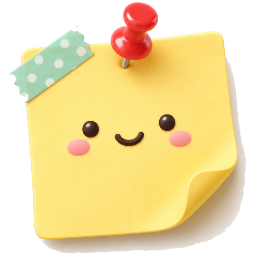

# PinPin Notes



**English** · [繁體中文](README.zh-TW.md) · [简体中文](README.zh-CN.md) · [日本語](README.ja.md) · [한국어](README.ko.md) · [العربية](README.ar.md)

[](https://github.com/ailazytech/pinpin-notes/stargazers) [](https://github.com/ailazytech/pinpin-notes/watchers) [](https://github.com/ailazytech) [](https://pinpin.fast01.net) [](https://github.com/ailazytech/pinpin-notes/actions/workflows/ci.yml) [](LICENSE) [](https://pinpin.fast01.net) [](https://www.rust-lang.org)

> **Little notes that stick with you.**

A cozy sticky-notes app for the Windows desktop — pins, washi tape, stickers, handwriting, transparent slogans and pomodoro timers, with almost zero idle CPU.

- One `.exe` (about 11 MB), no installer, Windows 10 / 11
- 0% CPU when idle, about 15 MB of memory (no idle timers at all — it only redraws when something changes)
- Six languages: English, 繁體中文, 简体中文, 日本語, 한국어, العربية (right-to-left)
- Open source (MIT); your notes stay on your own computer — at most one network request a day, optional anonymous usage stats ([privacy](docs/PRIVACY.md))

🌐 Website: **[pinpin.fast01.net](https://pinpin.fast01.net)** · 📦 Download: [from the website](https://pinpin.fast01.net) (coming soon) · 📝 [Changelog](CHANGELOG.md)

## Features

- **Sticky notes** — come back to the desktop when Windows starts; drag them around and they gently snap to other notes and screen edges (hold Alt to skip snapping, arrow keys nudge by 1 px)
- **Cross things out** — hover a line and a circle appears on its left; click it to strike the line through with a red pen (animated)
- **Pins, clips, washi tape, stickers** — drag them from the Sticker Shop onto a note or straight onto the desktop. 146 stickers (4× resolution, sharp when enlarged) in eight sections: everyday, good luck, lucky charms from around the world, plants, Chinese New Year couplets, cats & dogs, scooters, and Taiwan. Click one for handles: top-right rotates, bottom-right resizes; drag both ends of washi tape to stretch and turn it. Dragging an unselected pin, clip or tape moves the whole note
- **Your own stickers** — make a group in the Sticker Shop, then drop in images, press Ctrl+V or click “+”. The background is removed and a rounded white border is added; the original size is kept (up to 4096 px) and saved as JPEG XR to save space. Built-in stickers can be added to your groups too
- **Custom orders** — the last card in the Sticker Shop links to the custom page on the website (pet stickers, timer characters, theme sets)
- **Handwriting** — pen, highlighter, chalk and crayon, 8 colors, 3 sizes, eraser, Ctrl+Z to undo. **Clear paper** turns your handwriting into a slogan floating on the desktop
- **Text style** — color, font, bold and size (up to 6×). “Default text style” in the tray menu changes every note; “Text style (this note)” in the right-click menu changes one
- **Pomodoro timers** — tomato, hourglass, LED clock, alarm clock, a cat or a Shiba hugging a clock. Click to start / pause, scroll to set the minutes; rings when time is up (built-in chimes, the Windows alarm, your own .wav, or silent). Uses no power when it isn't running
- **Paper** — 8 classic colors + 8 Morandi colors + clear; sticky note, smooth, grid, lined, dot grid, washi and kraft-fiber textures
- **Pictures** — drop an image file in, or press Ctrl+V on a note, to get a Polaroid
- **Passwords** — each note can have its own password (PBKDF2 + AES-256-GCM). Normally it shows an ordinary-looking decoy to-do list; type the password and the text scrambles back into the real one. It locks itself again when closed or restarted
- **Starred notebook** — with the Vibotype selection toolbar, select text in any app and press ★ to collect it
- **Export / import JSON** — move to another computer or sync by hand (pictures, handwriting, your stickers and groups included; encrypted notes stay encrypted)
- **Desktop right-click** “New note” / “New timer” and **start with Windows** — both can be turned off in the tray menu
- **Online updates** — checks for new versions quietly (shown only in the tray menu); critical updates download automatically and apply on next launch; new sticker packs and shop banners can arrive online too. All of it can be turned off (see [docs/UPDATES.md](docs/UPDATES.md))
- **Languages** — add your own without rebuilding (see [locales/README.md](locales/README.md))

The full feature spec is in [docs/FEATURES.md](docs/FEATURES.md).

## Using it

- Tray icon: **left-click** for a new note, **right-click** for the menu (new handwriting, clear slogan and timer are there too)
- Handwriting: the pen at a note's top-right corner, or “Handwriting” in the right-click menu; Esc / Enter to finish, E toggles the eraser
- Timer: Space to start / pause, R to reset; right-click to change style, length and sound
- On a note: double-click to edit, right-click for the menu, Delete to delete (restore it from the tray menu), Ctrl+L to lock
- Data lives in `%APPDATA%\PinPin\`; the format is described in [docs/DATA.md](docs/DATA.md)

## Building

Needs Windows 10/11 and stable Rust (MSVC toolchain).

```powershell
cargo test
cargo build --release
.\target\release\pinpin.exe
```

Developer flags (while testing, set `$env:APPDATA` to a scratch folder so your real notes stay untouched):

| Flag | What it does |
|---|---|
| `--render-notes out.png` | Draw every note style into one image, without opening windows |
| `--render-shop out.png [section] [language]` | Draw the Sticker Shop into an image |
| `--render-stills folder light-wallpaper dark-wallpaper` | Website screenshots |
| `--export-sprites folder` | Assets for the promo video (one PNG per note and sticker) |
| `--make-art source output.png` | Prepare timer art: remove the background, add a thin white border, clear enclosed gaps |
| `--make-logo source folder` | Logo PNGs in every size plus `pinpin.ico` |
| `--check-update [--push]`, `--apply-update` | Test online updates (with `PINPIN_FEED=url`) |
| `--unborder folder prefix` | Remove the white border from stickers (couplets) |
| `--demo-notes` | Put a few sample notes on the desktop |
| `--shop` | Open the Sticker Shop on launch |
| `--new-note`, `--new-timer` | New note / timer (used by the desktop menu; handed to the running instance if there is one) |

## Project layout

```
src/              Rust source (app.rs: entry point and tray; notes/: the notes themselves)
locales/          UI translations (six JSON files, bundled at build time)
assets/           Pins, tape, stickers, timer art, logo (*-src folders hold the AI-generated originals)
site/             Website (Vite+, React, Tailwind; static output, deploy to any Pages host)
promo/remotion/   Promo video and website screenshots (Remotion)
docs/             Feature spec, data format, release process
```

## Talking to PinPin from other apps

Find the `PinPin.Main` window and send `WM_COPYDATA` (`dwData = 0x50424E31`) with UTF-8 JSON:

```json
{ "cmd": "note", "text": "Something to remember", "x": 100, "y": 200 }
{ "cmd": "star", "text": "Save this", "source": "chrome.exe" }
```

The pre-rename `PinBoard.Main` window still answers for now. Vibotype uses this protocol, so change both sides together (see [docs/DATA.md](docs/DATA.md#ipc)).

## Contributing

Issues and pull requests are welcome — see [CONTRIBUTING.md](CONTRIBUTING.md); releases are described in [docs/RELEASING.md](docs/RELEASING.md).

Want your own pet stickers or timer character? See the custom page on [the website](https://pinpin.fast01.net/#/custom), or email ailazytech@gmail.com.

## Star history

[](https://star-history.com/#ailazytech/pinpin-notes&Date)

## License

[MIT](LICENSE). The built-in pins, tape, stickers and timer art were made with AI image generation and post-processed; they are released under MIT as well.
